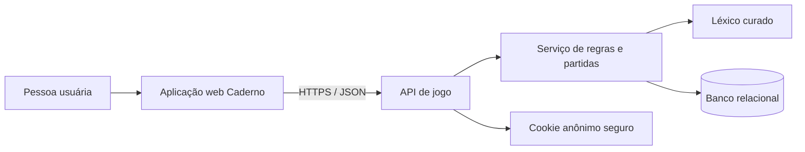
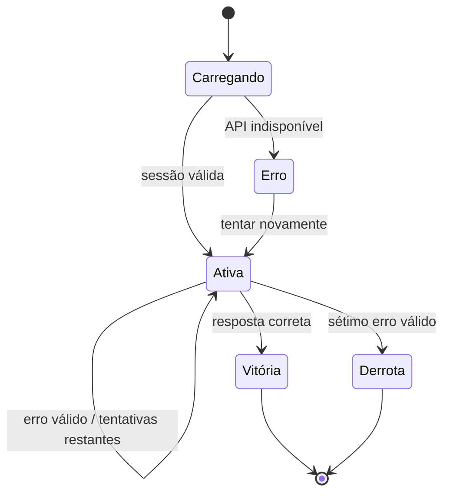

# Documento de Projeto Técnico — Entrelinhas

**Status:** proposta técnica revisada após implementação do MVP  
**Versão:** 0.1  
**Data:** 13 de outubro de 2026  
**PRD relacionado:** [PRD.md](PRD.md)  
**Direção visual:** Caderno, identificada como selecionada no protótipo compartilhado  
**Plataforma:** navegador web

> Este documento descreve como implementar uma versão de produção. Não é afirmação de que a arquitetura, o idioma final ou as regras ainda pendentes já tenham sido aprovados.

**Estado executável:** o MVP neste repositório usa HTML/CSS/JavaScript, servidor HTTP nativo do Node.js e SQLite via `node:sqlite`. Essa escolha permite executar e testar a aplicação sem instalar serviços externos. Fastify, TypeScript e PostgreSQL permanecem como uma opção de evolução, não como dependências atuais.

## 1. Resumo executivo

O MVP executável é um jogo web de dedução por letras com desafio diário, prática livre, arquivo de 30 dias e estatísticas. A interface usa a experiência editorial do conceito **Caderno**. O servidor valida palpites, mantém respostas fora do cliente, persiste sessões e calcula estatísticas no SQLite local.

O protótipo comparativo foi substituído no fluxo publicado: a aplicação não exibe seletor de tema, painel de revisão nem estatísticas fictícias. A lista lexical atual é uma seed pequena mantida no servidor e serve à demonstração funcional; ela ainda requer revisão editorial antes de um lançamento público.

## 2. Decisões, propostas e pendências

### Confirmado no PRD

- Jogo casual no navegador, sem anúncios.
- Dedução por letras, até sete palpites por partida.
- Desafio diário, prática livre, arquivo e estatísticas.
- Níveis de dificuldade.
- Público prioritário de 15 a 40 anos.
- Direção Caderno selecionada no estado compartilhado do protótipo.

### Propostas desta arquitetura

- Frontend em TypeScript, preservando HTML semântico, CSS e o estilo visual já implementado.
- API em Node.js/TypeScript e PostgreSQL como fonte autoritativa para partidas diárias, palavras secretas e resultados.
- Sem conta obrigatória no MVP; identidade de visitante anônima via cookie seguro.
- Mesmo desafio diário para todos no idioma/localidade escolhidos, com rollover em um fuso único.
- Partidas livres não alteram sequência nem estatísticas do desafio diário.
- Comprimento padrão de cinco letras no primeiro lançamento; motor preparado para configuração por desafio.
- No MVP, cada nível tem um desafio diário próprio; a estatística agrega vitórias por data. Isso é uma decisão provisória, pois o PRD ainda não definiu se a palavra é única entre níveis.

Essas propostas requerem validação de produto antes de se tornarem contratos estáveis.

### Pendências que bloqueiam conteúdo definitivo

- Idioma e variante regional de lançamento.
- Comprimento de palavra, equivalência de acentos, cedilha, letras repetidas e formas aceitas.
- Fuso e horário de troca do desafio.
- Quantidade e critérios objetivos dos níveis.
- Janela do arquivo e regra de sequência diária.
- Persistência somente local ou sincronização entre dispositivos.
- Metas formais de disponibilidade, desempenho e conformidade WCAG.

## 3. Direção visual Caderno

A produção deve preservar a hierarquia editorial, foco no tabuleiro, uso contido de cor e ritmo calmo do conceito Caderno.

### Tokens do protótipo a validar

| Token | Valor atual | Uso |
|---|---|---|
| Fundo da página | `#f4f1e8` | Plano geral |
| Superfície | `#fbfaf6` | Área do jogo e painéis |
| Texto principal | `#232822` | Títulos e conteúdo |
| Texto auxiliar | `#72766d` | Metadados e ajuda |
| Acento | `#d45d42` | Ação principal e seleção |
| Letra correta | `#176a57` | Acerto de posição |
| Letra presente | `#e1ad43` | Letra em outra posição |
| Letra ausente | `#555b54` | Letra não encontrada |
| Títulos | DM Serif Display | Hierarquia editorial |
| Interface | DM Sans | Texto e controles |
| Dados/índices | DM Mono | Metadados e grade |

Os valores são um ponto de partida visual, não uma declaração de conformidade de contraste. Validar contraste real de texto, foco e estados antes do lançamento. Para eliminar uma chamada de terceiro no MVP, a interface usa fontes locais de sistema: Georgia para títulos, Trebuchet MS/Verdana para interface e Liberation Mono/Courier New para metadados. Se fontes de marca forem adotadas depois, auto-hospedá-las após confirmar a licença.

### Regras de apresentação

- Uma área principal sem distrações, com a tentativa atual e o botão de envio como foco.
- Títulos editoriais, metadados compactos e painéis com bordas discretas, sem cartões aninhados.
- A grade mantém dimensões fixas; resultados não podem deslocar a página.
- Estado não é comunicado só por cor: manter os marcadores visuais existentes e fornecer rótulos acessíveis.
- Usar movimento breve e não essencial; respeitar `prefers-reduced-motion`.
- A versão de produção contém somente a identidade escolhida. Remover o seletor Caderno/Estufa/Recorte e o painel temporário de revisão de design.

## 4. Arquitetura proposta

### 4.1 Visão geral



**Navegador:** entrega HTML/CSS/JS compilado, controles acessíveis, estado visual e chamadas à API. Não recebe a palavra secreta antes de a rodada terminar.

**API:** valida entradas e transições de estado, atribui feedback às letras, controla as sete tentativas, resolve o desafio ativo, processa arquivo e agrega estatísticas.

**Banco relacional:** mantém catálogo editorial de palavras, desafios diários e registros mínimos de sessões/resultados. O MVP usa SQLite; uma implantação com múltiplas instâncias pode migrar para PostgreSQL. Respostas futuras e metadados internos não são publicados no bundle web.

### 4.2 Pilha técnica recomendada para evolução

A pilha é uma recomendação, não uma tecnologia imposta pelo PRD:

- **Web:** Vite + TypeScript sem framework inicialmente. O protótipo já é HTML/CSS/JavaScript simples; TypeScript e módulos melhoram os contratos e testes sem trazer runtime de UI desnecessário.
- **Servidor:** Node.js LTS + TypeScript + Fastify, com validação de esquemas na borda da API.
- **Persistência:** PostgreSQL com migrações versionadas.
- **Testes:** Vitest para domínio e serviços; Playwright para jornadas e responsividade; axe-core e verificação manual de teclado/leitor de tela para acessibilidade.
- **Contrato:** OpenAPI para documentar os endpoints, códigos de erro e tipos compartilhados.
- **Hospedagem:** frontend e API sob a mesma origem HTTPS, ou proxy reverso com CORS restrito se a separação for necessária.

**Pilha atual do MVP:** HTML sem framework, CSS Caderno, JavaScript em módulos simples, `node:http`, `node:sqlite` e testes `node:test`; requer Node.js 22.5 ou superior. Não há dependências npm de runtime nem serviço de banco externo. O arquivo de banco é criado em `data/entrelinhas.sqlite` e está excluído do controle de versão.

A evolução para Fastify/PostgreSQL deve ser tratada como uma migração deliberada, com ambiente de banco, migrações, operação e CI configurados. A versão atual é adequada a uma instância local/single-process; ela não oferece sincronização de estatísticas entre dispositivos nem foi dimensionada para múltiplas instâncias.

### 4.3 Organização alvo sugerida para evolução

```text
src/
  app/                  # Inicialização, roteamento e composição de telas
  domain/               # Tipos e regras puras compartilháveis
  features/
    game/               # Tabuleiro, entrada, modos e estado da partida
    stats/              # Painel e formatação das métricas
    archive/            # Lista e retomada de desafios passados
  services/api-client.ts
  styles/
    tokens.css          # Variáveis e tokens Caderno
    base.css
    components.css
server/
  routes/               # Rotas HTTP e validação de requests
  game/                 # Motor de regras e casos de uso
  repositories/         # Consultas e transações de persistência
  security/             # Cookie, rate limit e cabeçalhos
  content/              # Importação e validação editorial do léxico
  app.ts
shared/
  api-contracts.ts
  domain-types.ts
db/
  migrations/
  seeds/
tests/
  unit/
  integration/
  e2e/
```

## 5. Domínio e regras de jogo

### 5.1 Entidades

- **WordEntry:** palavra normalizada, forma de exibição, idioma, comprimento, nível, frequência estimada, estado editorial e permissão para palpite e/ou resposta.
- **DailyChallenge:** data de jogo, idioma/localidade, nível e referência à palavra escolhida. Restrição única por data e localidade.
- **GameSession:** identificador opaco, visitante, modo (`daily`, `practice` ou `archive`), desafio associado quando aplicável, nível, tentativas usadas, estado (`active`, `won`, `lost`), início e fim.
- **Guess:** sequência da tentativa, valor normalizado, feedback calculado e instante de envio. Guardar somente os dados necessários para restaurar a partida, resolver duplicidade e apresentar estatísticas; não guardar telemetria de digitação.
- **Resultado diário:** resultado final por visitante/desafio, quantidade de tentativas e vitória/derrota. No MVP, as métricas são derivadas de `game_sessions`; não existe tabela agregada `daily_results`.

A estrutura final depende das regras aprovadas de idioma, conta e arquivo. Os identificadores de sessão não devem conter palavra ou nível secreto.

### 5.2 Algoritmo de feedback

1. Validar formato e verificar que a palavra está na lista de palpites permitidos.
2. Percorrer resposta e palpite para marcar primeiro as letras corretas na posição correta.
3. Contar somente as letras da resposta que ainda não foram consumidas.
4. Percorrer as posições restantes do palpite; marcar como presente enquanto houver ocorrência disponível e reduzir o contador.
5. Marcar as posições não correspondentes como ausentes.

Esse procedimento evita indicar uma letra repetida como presente mais vezes do que ela aparece na resposta. Implementar como função determinística e testá-la isoladamente. Não recalcular o resultado no cliente como autoridade; o cliente apenas renderiza o feedback devolvido pelo servidor.

### 5.3 Normalização lexical

A normalização deve ser explícita, centralizada e testável no servidor. Ela pode incluir remoção de espaços periféricos, normalização Unicode e conversão de caixa. Não decidir a remoção de acentos, equivalência entre variantes ou aceitação de flexões até a política linguística ser aprovada.

Contar letras por unidades linguísticas definidas para o idioma, não por bytes. Para suporte a caracteres compostos, tratar normalização Unicode e segmentação de grafemas de maneira consistente no servidor e no cliente. A forma original da resposta é preservada para apresentação.

### 5.4 Máquina de estados



O servidor deve rejeitar palpites após terminalidade, com estado `409 GAME_FINISHED`, e garantir que envio repetido do mesmo request não consuma duas tentativas.

## 6. Persistência e dados

### 6.1 Modelo relacional inicial

| Tabela | Campos principais | Restrições/observações |
|---|---|---|
| `word_entries` | `id`, `locale`, `display_word`, `normalized_word`, `length`, `difficulty`, `answer_allowed`, `guess_allowed`, `editorial_status` | Índice por idioma, forma normalizada e comprimento; somente palavras aprovadas entram em desafios |
| `daily_challenges` | `id`, `challenge_date`, `locale`, `difficulty`, `word_entry_id` | MVP: `UNIQUE(challenge_date, locale, difficulty)`; palavra não retornada em endpoint público |
| `visitors` | `id`, `created_at`, `last_seen_at` | UUID aleatório associado a cookie `HttpOnly`, `Secure`, `SameSite=Lax` |
| `game_sessions` | `id`, `visitor_id`, `mode`, `challenge_id`, `difficulty`, `status`, `attempts_used`, `started_at`, `finished_at` | Para prática, resposta vinculada apenas no lado do servidor; limite de tentativas validado em transação |
| `guesses` | `id`, `session_id`, `sequence`, `normalized_guess`, `feedback`, `created_at` | `UNIQUE(session_id, sequence)`; retenção mínima e política de privacidade por definir |
| `guess_requests` | `session_id`, `idempotency_key`, `response_json` | Armazena a resposta ao mesmo request para retries de rede sem consumir outro palpite |
| Resultado diário (derivado) | Sessões diárias em `game_sessions` com `status` terminal | No MVP, métricas são consultas derivadas; a sessão diária única por visitante/data/nível evita duplicidade |

A palavra secreta usada na sessão pode ser resolvida por relação interna segura com o desafio. As consultas e serializadores públicos devem usar projeções permitidas, não serializar entidades do banco integralmente.

### 6.2 Persistência do visitante

Proposta para MVP sem conta: API emite cookie aleatório opaco, `HttpOnly`, `Secure` em produção e `SameSite=Lax`; o cookie não contém informação pessoal nem a resposta. Isso mantém estatísticas anônimas no mesmo navegador. Limpar cookies perde a associação. Sincronização entre dispositivos exigiria conta ou fluxo de transferência, ainda fora de escopo.

O cliente serializa o bootstrap de visitante entre abas com Web Locks quando esse recurso está disponível; fora dele, a carga continua sequencial dentro de cada aba, mas navegadores sem Web Locks ainda podem criar identidades distintas se duas abas forem abertas simultaneamente pela primeira vez.

Definir retenção e exclusão dos registros antes da produção. O MVP não expira sessões/visitantes no banco nem implementa fluxo de exclusão, portanto ainda não deve ser publicado para audiência aberta sem decisão de retenção. Evitar analytics de terceiros por padrão; qualquer medição adicional precisa de revisão de privacidade e aprovação.

## 7. API HTTP proposta

Prefixo: `/api/v1`. Conteúdo JSON UTF-8. O MVP não publica OpenAPI; os endpoints abaixo são o contrato implementado, exceto `GET /config`, que continua apenas como proposta futura.

| Método e rota | Uso | Resposta esperada |
|---|---|---|
| `GET /config` | Configuração pública, idioma e política de tentativas | Não implementado no MVP |
| `GET /challenges/today` | Carregar desafio atual | `challengeId`, data, comprimento, nível e sessão ativa/concluída; sem palavra secreta |
| `GET /challenges/archive?cursor=...` | Listar desafios disponíveis e status do visitante | Datas e metadados públicos; sem respostas não resolvidas |
| `POST /sessions` | Criar sessão de prática ou arquivo | `sessionId`, modo, comprimento, palpites permitidos e tentativas disponíveis |
| `GET /sessions/:id` | Restaurar sessão após recarga | Estado, histórico de palpites e resultado terminal se finalizada |
| `POST /sessions/:id/guesses` | Enviar um palpite | Feedback por posição, tentativas restantes, estado; resposta secreta somente depois de `won` ou `lost` |
| `GET /stats` | Obter estatísticas do visitante | Métricas diárias derivadas de resultados persistidos |

Exemplo de resultado de um palpite ativo:

```json
{
  "guess": "NORTE",
  "feedback": ["absent", "present", "correct", "absent", "absent"],
  "attemptsUsed": 3,
  "attemptsRemaining": 4,
  "status": "active"
}
```

Em estado terminal, incluir `revealedAnswer` apenas para a sessão que terminou. Nunca incluir a palavra alvo em headers, HTML inicial, sourcemaps, logs de frontend ou payloads de sessão ativa.

### Erros relevantes

- `400 INVALID_GUESS_FORMAT`: comprimento ou caracteres incompatíveis.
- `422 WORD_NOT_ALLOWED`: palavra não consta na lista de palpites válidos.
- `404 SESSION_NOT_FOUND`: sessão inexistente ou não acessível ao visitante.
- `409 GAME_FINISHED`: sessão já terminou.
- `409 DAILY_RESULT_EXISTS`: resultado diário já foi registrado; retornar o estado existente em vez de contabilizar novamente.
- `429 RATE_LIMITED`: limite temporário de requests atingido.
- `503 DAILY_CHALLENGE_UNAVAILABLE`: desafio não foi publicado ou serviço indisponível.

As respostas de erro não podem conter segredo ou detalhes internos.

## 8. Jornadas técnicas

### 8.1 Desafio diário

1. O navegador solicita `GET /challenges/today`.
2. A API determina o dia conforme o fuso aprovado, carrega o desafio publicado e identifica o visitante pelo cookie.
3. Se existir uma sessão diária do visitante, a API devolve a sessão e o histórico; caso contrário, cria uma sessão sem expor a palavra.
4. A pessoa envia o palpite. O servidor valida lista, comprimento, estado e tentativas dentro de transação.
5. O servidor calcula feedback e persiste palpite e contador atomicamente.
6. Se houver vitória ou sétimo erro, encerra a sessão e grava `daily_results` de forma idempotente. Só então inclui a resposta na payload final.
7. O cliente anuncia o estado, atualiza o tabuleiro e solicita as estatísticas atualizadas.

### 8.2 Prática livre

1. A pessoa escolhe nível e solicita `POST /sessions` com modo `practice`.
2. O servidor escolhe uma palavra válida para o nível, cria sessão e devolve apenas metadados públicos.
3. Palpites seguem o mesmo endpoint e motor de regras.
4. Sessões de prática não atualizam resultados nem sequência diária.
5. Após o fim, a pessoa pode solicitar outra sessão.

### 8.3 Arquivo

1. A API lista dias publicados no arquivo e o estado de jogo do visitante.
2. A pessoa seleciona um desafio anterior.
3. O servidor cria ou restaura uma sessão de arquivo para aquele desafio.
4. A resposta permanece oculta até a sessão terminar.
5. Registros antigos não são contados como novo desafio diário concluído.

## 9. Estatísticas

Calcular as métricas a partir de `daily_results`, não dos números estáticos do protótipo:

- **Partidas concluídas:** resultados diários únicos com estado terminal.
- **Taxa de vitória:** vitórias divididas por partidas concluídas; exibir vazio/zero de forma definida quando não houver partidas.
- **Média de palpites:** média apenas das vitórias, salvo decisão diferente.
- **Distribuição:** contagem de vitórias por tentativa de 1 a 7.
- **Sequência:** derivada da série de datas diárias e resultados, com regra explícita de perda e ausência de jogo.

O PRD ainda não decide se a prática aparece no painel. Proposta: separar resultados diários das métricas de prática e rotular cada seção com clareza. Remover os valores 24/79%/4/4,1 e a distribuição de exemplo do protótipo antes do lançamento.

## 10. Segurança, privacidade e operação

- Servir todo o produto por HTTPS.
- Nunca enviar lista de respostas ou resposta ativa ao bundle do navegador.
- Validar sessão, modo, comprimento, vocabulário, contador e status no servidor; nunca confiar no contador informado pelo cliente.
- Atualizar tentativa e resultado em transação para impedir concorrência e contagem duplicada.
- Usar cookie aleatório opaco, `HttpOnly`, `Secure`, `SameSite=Lax`; não incluir ID de sessão ou resposta em URL compartilhável.
- Limitar requests por visitante e endereço de conexão; processar retries com a mesma chave idempotente antes de consumir a cota de palpite.
- O MVP aplica limites em memória: 40 palpites por visitante/minuto, 200 por endereço/minuto, 20 sessões por visitante/minuto, 60 por endereço/minuto, 20 desafios diários por visitante/minuto, 60 por endereço/minuto e 300 requests gerais por endereço/minuto. O limite geral não bloqueia retries do endpoint idempotente de palpites. As cotas reiniciam com o processo e não substituem proteção distribuída em múltiplas instâncias. Atrás de proxy, usar somente proxies confiáveis para determinar o endereço de origem.
- Definir CSP, `X-Content-Type-Options` e política de origem; restringir CORS se houver origens distintas.
- Renderizar palavras como texto, não HTML; validar conteúdo editorial antes de publicação.
- Não registrar respostas secretas, cookies ou palpites associados a IP em logs desnecessários.
- Publicar política de privacidade e retenção de dados antes de coletar qualquer informação além do estado necessário do jogo.
- Manter rotina de backup e restauração do banco, migrações reversíveis quando possível e alerta para ausência do desafio diário.

## 11. Acessibilidade e qualidade visual

- Meta proposta: WCAG 2.2 AA, sujeita a validação.
- Controles nativos de formulário, nomes acessíveis, foco visível e navegação completa por teclado.
- Cada célula deve expor letra e estado em texto; não depender do pseudo-elemento CSS como único anúncio para leitor de tela.
- Região `aria-live="polite"` para resultado e erros, sem ler novamente todo o tabuleiro a cada atualização.
- Cores de acerto devem manter contraste mínimo necessário e indicação redundante. Verificar os tokens reais com ferramenta de contraste.
- Atender zoom, tamanhos de fonte maiores, reflow em 320 CSS px, orientação móvel e movimento reduzido.
- Testar ao menos teclado sem mouse, NVDA/Firefox ou combinação equivalente, VoiceOver/Safari quando disponível e simulação de deficiências de visão cromática.
- No tema Caderno, manter o estilo editorial sem sacrificar legibilidade, área de toque ou visibilidade de foco.

## 12. Estratégia de testes

### Unitários

- Algoritmo de feedback: letra correta, presente fora de posição, ausente e combinações com duplicadas.
- Normalização Unicode e validação por locale/comprimento.
- Transições `active -> won/lost`, sete palpites e rejeição após terminalidade.
- Cálculo de taxa, média, distribuição e sequência.
- Seleção determinística do desafio diário para a mesma data/localidade.

### Integração

- Criar e restaurar sessão diária e de prática.
- Persistência atômica de palpite e resultado.
- Idempotência de requests repetidos e resultado diário único.
- Resposta ativa não contém segredo; resposta terminal contém somente o necessário.
- Arquivo não altera estatística diária.
- Cookie anônimo e isolamento de sessão entre visitantes.

### E2E e acessibilidade

- Começar o desafio, submeter palpite válido, vencer e perder.
- Entrada inválida não consome tentativa.
- Trocar entre diário, prática, arquivo e estatísticas.
- Trocar o nível antes de começar; impedir mudança de dificuldade após partida iniciada.
- Recarregar e restaurar uma sessão em andamento.
- Verificar layouts desktop e 320/375 px, sem overflow horizontal.
- Executar axe-core e testes manuais de teclado/leitor de tela.

### Critérios de liberação

- Todos os testes de domínio, integração e E2E obrigatórios passam no CI.
- Nenhuma resposta ativa é encontrável em assets públicos, requests de sessão ou sourcemaps.
- Contraste, teclado, foco e anúncios do leitor de tela foram revisados.
- Há pelo menos uma palavra válida publicada para cada data/localidade de lançamento e alerta de falha de publicação.
- Estatísticas exibidas correspondem a resultados reais; nenhum dado de demonstração permanece.

## 13. Implantação e observabilidade

- **Ambientes:** local, staging e produção, com conjuntos de palavras separados e sem respostas reais de produção em staging.
- **Build:** pipeline instala dependências travadas, executa lint, testes, compilação e verificação de acessibilidade automatizada.
- **Deploy:** frontend e API publicados na mesma origem; migrações executadas como etapa explícita, com backup prévio em produção.
- **Logs:** o MVP registra apenas erros resumidos no console; antes de produção, adicionar request ID, rota, status e latência, sem registrar cookie ou palavra secreta.
- **Métricas técnicas:** latência de API, taxa de erro por endpoint, falhas de carregamento do desafio, falha de persistência e disponibilidade do banco.
- **Alertas:** ausência do desafio do dia próximo ao horário de publicação, aumento de `5xx`, erros de banco e latência acima do SLO aprovado.
- **SLO inicial proposto:** API de palpites com p95 abaixo de 300 ms em região de hospedagem próxima ao público; validar após escolher provedor e executar teste de carga. Não é compromisso até ser aprovado.

## 14. Plano de implementação

1. **Fechar decisões editoriais e regras:** locale, tamanho, acentos, dicionário, níveis, fuso, estatísticas e janela do arquivo.
2. **Extrair domínio do protótipo:** tipos, normalização configurável, algoritmo de feedback e testes unitários.
3. **Preparar aplicação web:** Vite/TypeScript, tokens Caderno, componentes acessíveis, roteamento de tela e estados de carregamento/erro.
4. **Implementar API e persistência:** migrações, visitante anônimo, sessões, serviço de jogo e endpoints.
5. **Adicionar conteúdo:** pipeline de importação/revisão, validação do léxico e publicação agendada de desafios.
6. **Implementar modos e dados:** desafio diário, prática, arquivo, restauração de sessão e estatísticas reais.
7. **Endurecer e validar:** segurança, acessibilidade, responsividade, E2E, carga, privacidade e operação.
8. **Lançar gradualmente:** staging com conteúdo de teste, piloto limitado, monitoramento e expansão após critérios de liberação.

## 15. Riscos e mitigação

| Risco | Consequência | Mitigação |
|---|---|---|
| Lista de palavras não é justa para o locale | Frustração, reclamações e abandono | Editorias de inclusão/exclusão, teste linguístico e revisão antes da publicação |
| Resposta enviada ao cliente | Spoilers e manipulação do desafio | Validação exclusivamente server-side e teste automatizado de payloads/assets |
| Conta não definida, mas estatísticas precisam sobreviver | Perda de histórico ou escopo excessivo | MVP anônimo por cookie; deixar claro que não sincroniza entre dispositivos |
| Fuso de troca indefinido | Pessoas recebem dias diferentes | Aprovar um fuso único e exibi-lo na política do desafio |
| Dificuldade sem definição mensurável | Níveis apenas cosméticos | Classificar palavras e calibrar com testes de jogadores |
| Métricas fictícias permanecem no lançamento | Perda de confiança | Bloquear release se placeholders de estatística estiverem ativos |
| Fonte de terceiros falha ou rastreia usuários | Mudança visual e impacto de privacidade | Auto-hospedar fontes licenciadas ou aprovar dependência conscientemente |

## 16. Referências ao estado atual do projeto

O MVP atual usa `index.html`, `styles.css`, `client.js`, `server.mjs` e `server.test.mjs`. A UI segue Caderno; a API local implementa desafio diário por nível, prática livre, arquivo dos 30 dias anteriores, persistência de sessões e estatísticas anônimas. O segredo fica no servidor, requests de palpite são idempotentes e o feedback de letras repetidas é coberto por teste. O léxico é uma seed pequena de demonstração, as palavras têm cinco letras e a política de idioma/acentos continua como definida no PRD. Execute com `npm start`, acesse `http://localhost:4174`, rode `npm test` para as regras/API e `npm run check` para sintaxe. O servidor escuta em `127.0.0.1` por padrão; `HOST` só deve ser definido para outra interface quando houver HTTPS e uma implantação protegida. O arquivo [PRD.md](PRD.md) permanece a fonte funcional; Fastify/PostgreSQL e a estrutura de diretórios descrita acima são propostas de evolução.
